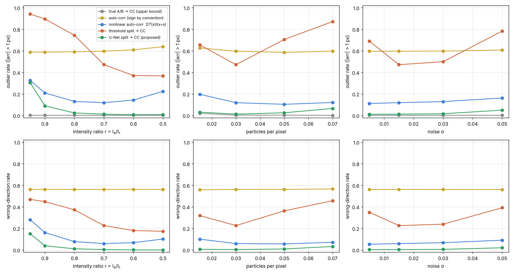
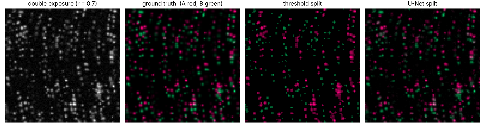

# PIV term project — AI separation of pulse-coded double exposures

## 문제
Single-frame / double-exposure PIV는 auto-correlation으로 변위를 구하지만, 상관함수가
대칭(R(s) = R(−s))이라 **방향 모호성**이 생긴다 (Ch4 p.30, 33).
두 펄스가 똑같으면 영상 자체가 방향에 대해 대칭이므로 어떤 알고리즘(AI 포함)으로도 부호를 알 수 없다.

강의 p.34의 해결책 중 **pulse coding**(두 펄스 세기를 다르게: I₂ = r·I₁, r < 1)을 사용하고,
U-Net이 한 장의 double exposure를 **frame A(1st pulse) / frame B(2nd pulse)** 로 분리하게 한 뒤
일반 cross-correlation을 적용한다 → auto-correlation 문제를 cross-correlation 문제로 변환.

어려운 점: 입자 밝기는 light sheet 안의 z 위치에 따라 크게 달라서(가우시안 sheet profile),
밝기만으로는 1st/2nd를 가를 수 없다. 같은 입자 쌍(밝기 비 r, 주변과 같은 변위)이라는 **문맥**을 써야 한다.

## 구성
| 파일 | 내용 |
|---|---|
| `pivsep/synth.py` | 합성 PIV 영상 생성 (비압축 랜덤 유동 + Lamb–Oseen 와류, erf 적분 가우시안 입자, light-sheet 밝기 분포, 면외 운동, 노이즈) |
| `pivsep/correlation.py` | FFT cross-correlation / auto-correlation / 비선형 auto-correlation ΣI²(x)I(x+s), 3-point Gaussian subpixel |
| `pivsep/separation.py` | 고전 기법(blob 밝기 + Otsu 임계값) 분리, U-Net 분리 (soft mask, A+B=I 보존) |
| `scripts/train_sep.py` | U-Net 학습 (r ∈ [0.45, 0.95], 밀도·노이즈·입자 크기 랜덤) |
| `scripts/evaluate.py` | r, 입자 밀도, 노이즈 sweep 평가 |
| `scripts/make_figures.py` | 그림 생성 |

## 실행
```bash
python -m venv .venv && . .venv/bin/activate && pip install -r requirements.txt
python scripts/train_sep.py --steps 3000        # CPU 약 35분
python scripts/evaluate.py
python scripts/make_figures.py
```

## 비교 방법
- `gt_cc` : 정답 A, B로 cross-correlation (상한)
- `auto` : auto-correlation, 부호는 관례(dx>0)로 선택 → 방향 모호
- `asym` : 비선형 auto-correlation ΣI²(x)I(x+s). +d 피크 ∝ r, −d 피크 ∝ r² 이므로 큰 쪽이 방향 (고전 기법 baseline)
- `thr_cc` : blob 밝기 임계값 분리 → CC
- `unet_cc` : U-Net 분리 → CC (제안)

평가: interrogation window 32×32, step 16 (50 % overlap), 256×256 영상 12장(조건당 2700 벡터).
지표: outlier 비율(|오차| > 1 px), 방향 오류 비율(u·u_gt < 0), median 오차.

## 결과 (1차, U-Net 3000 step / CPU 35분, val loss 2.08e-3)
기준: 상수 mask 4.5e-3, 정답 mask 0.41e-3 → 아직 학습 여지 있음.

### r (펄스 세기비) sweep — outlier 비율 / 방향 오류 비율 (ppp 0.03, noise 0.015)
| r | auto-corr | 비선형 auto-corr | threshold→CC | **U-Net→CC** | 정답 A/B→CC |
|---|---|---|---|---|---|
| 0.95 | 59% / 56% | 33% / 28% | 94% / 47% | **31% / 15%** | 0.4% / 0% |
| 0.9 | 59% / 56% | 21% / 16% | 90% / 45% | **9.0% / 3.9%** | 0.4% / 0% |
| 0.8 | 59% / 56% | 13% / 7.7% | 75% / 37% | **2.4% / 1.1%** | 0.4% / 0% |
| 0.7 | 60% / 56% | 12% / 5.9% | 47% / 23% | **1.3% / 0.4%** | 0.4% / 0% |
| 0.6 | 61% / 56% | 14% / 6.8% | 37% / 18% | **0.7% / 0.1%** | 0.4% / 0% |
| 0.5 | 64% / 56% | 23% / 10% | 37% / 17% | **0.8% / 0.0%** | 0.4% / 0% |

median 오차 (r = 0.7): 정답 A/B→CC 0.14 px, **U-Net→CC 0.16 px**, auto-corr(oracle 부호) 0.27 px, 비선형 auto-corr 0.26 px.





### 관찰
1. 일반 auto-correlation은 r과 무관하게 방향을 알 수 없다 (방향 오류 ≈ 50–56 %, 대칭성 때문).
2. 고전 비선형 auto-correlation도 펄스 코딩으로 방향을 어느 정도 정하지만 outlier 12 % 이상이 남는다.
3. 밝기 임계값 분리는 z에 따른 밝기 편차 때문에 실패한다 (같은 펄스 안에서도 밝기가 크게 달라짐).
4. **U-Net 분리 → CC는 r ≤ 0.8에서 outlier 1–2 %, 방향 오류 ≈ 1 % 이하**로 정답 A/B를 쓴 상한에 근접.
   auto-correlation(부호를 알려준 경우)보다도 median 오차가 작다 — 분리 후 CC는 자기 피크(0 변위)가 없어서 피크 검출이 깨끗함.
5. 픽셀 단위 오분류율은 약 20 %로 threshold와 비슷하지만, CC는 창 안 평균이라 **입자 쌍의 다수만 맞으면** 변위가 정확히 나온다.
6. 한계: r → 1 (0.95)에서는 정보가 사라져 성능 하락. 학습 범위 밖(ppp 0.07, noise 0.05)에서 outlier 5–7 %로 증가.

### 다음 단계 후보
- 학습 연장 / BCE 손실(`--loss bce`) 비교, 학습 범위 확장
- multi-pass + window deformation과 결합, 와류 영역 분석
- 2단계: 3번 주제(질량 보존, ∇·u = 0) 후처리
