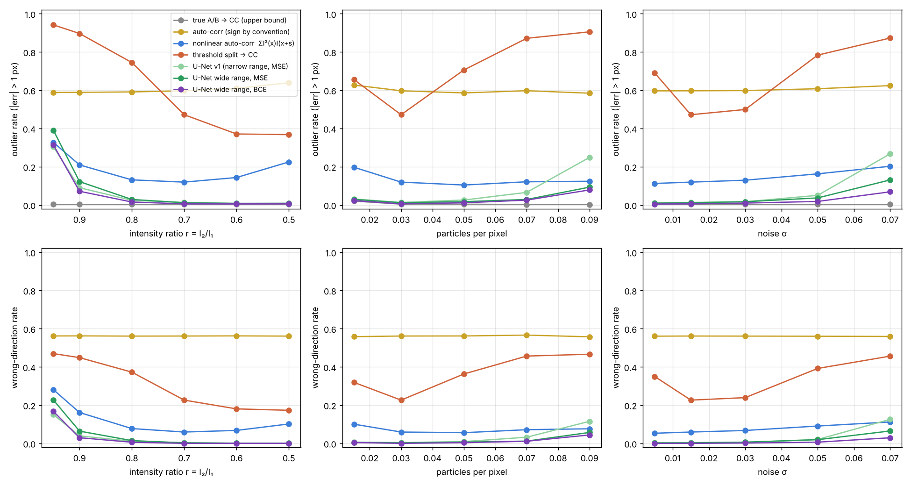
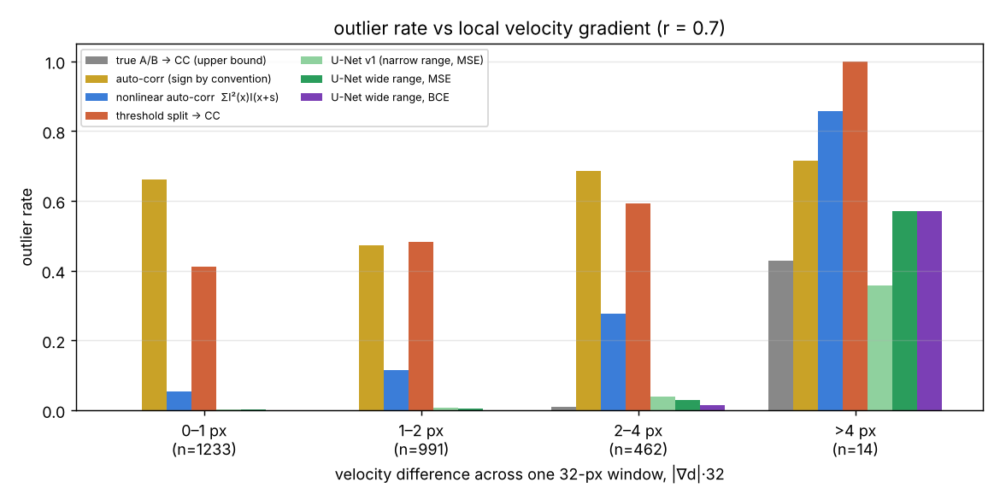
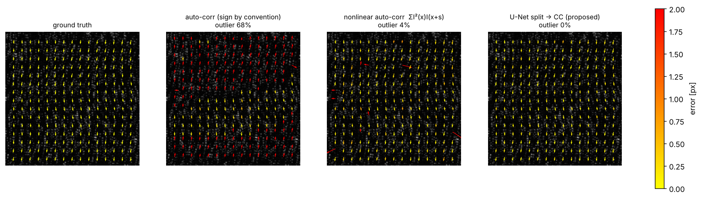
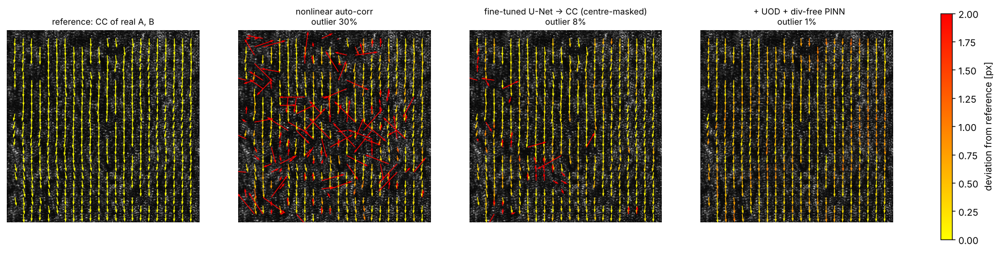
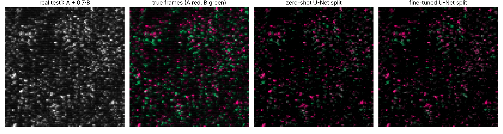
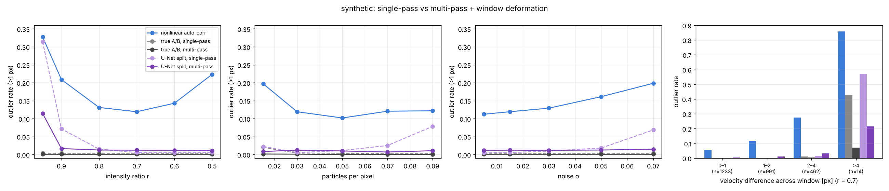
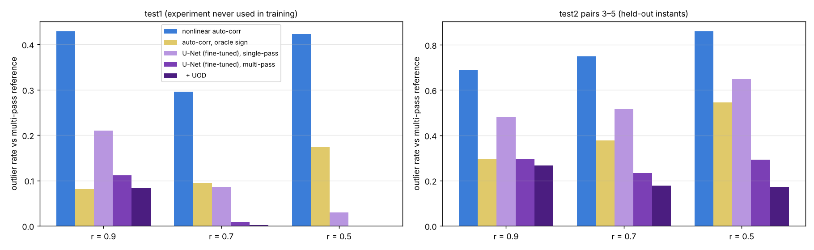
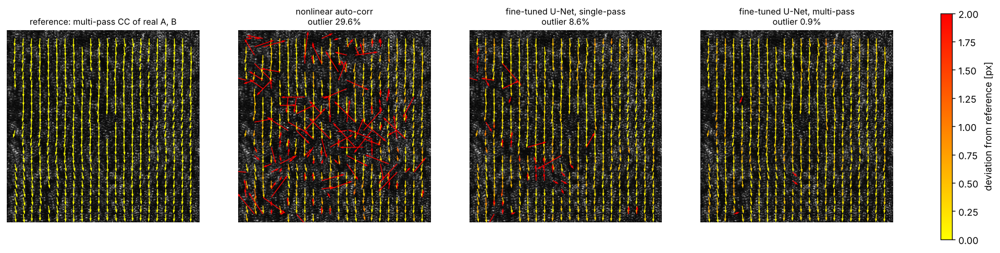
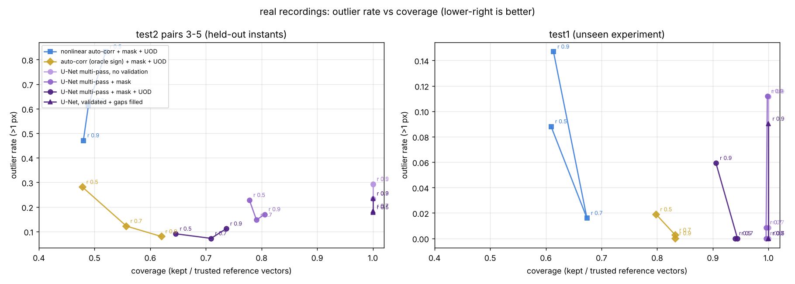
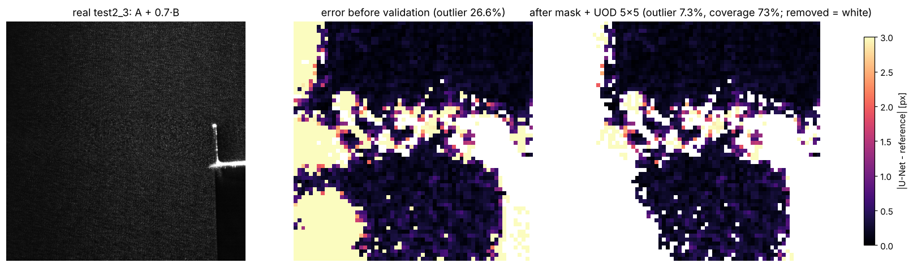

# PIV term project — AI separation of pulse-coded double exposures + div-free post-processing

## 문제
Single-frame / double-exposure PIV는 auto-correlation으로 변위를 구하지만, 상관함수가
대칭(R(s) = R(−s))이라 **방향 모호성**이 생긴다 (Ch4 p.30, 33).
두 펄스가 똑같으면 영상 자체가 방향에 대해 대칭이므로 어떤 알고리즘(AI 포함)으로도 부호를 알 수 없다.

강의 p.34의 해결책 중 **pulse coding**(두 펄스 세기를 다르게: I₂ = r·I₁, r < 1)을 사용하고,
U-Net이 한 장의 double exposure를 **frame A(1st pulse) / frame B(2nd pulse)** 로 분리하게 한 뒤
일반 cross-correlation을 적용한다 → auto-correlation 문제를 cross-correlation 문제로 변환.

어려운 점: 입자 밝기는 light sheet 안의 z 위치에 따라 크게 달라서(가우시안 sheet profile),
밝기만으로는 1st/2nd를 가를 수 없다. 같은 입자 쌍(밝기 비 r, 주변과 같은 변위)이라는 **문맥**을 써야 한다.

## 구성
| 파일 | 내용 |
|---|---|
| `pivsep/synth.py` | 합성 PIV 영상 생성 (비압축 랜덤 유동 + Lamb–Oseen 와류, erf 적분 가우시안 입자, light-sheet 밝기 분포, 면외 운동, 노이즈) |
| `pivsep/correlation.py` | FFT cross-correlation / auto-correlation / 비선형 auto-correlation ΣI²(x)I(x+s), 3-point Gaussian subpixel |
| `pivsep/separation.py` | 고전 기법(blob 밝기 + Otsu 임계값) 분리, U-Net 분리 (soft mask, A+B=I 보존) |
| `scripts/train_sep.py` | U-Net 학습 (r ∈ [0.45, 0.95], 밀도·노이즈·입자 크기 랜덤) |
| `scripts/evaluate.py` | r, 입자 밀도, 노이즈 sweep 평가 |
| `scripts/make_figures.py` | 1단계 그림 |
| `pivsep/postproc.py` | 2단계: UOD + 중앙값 대체, 강건 stream-function LS, 발산 0 PINN |
| `scripts/evaluate_postproc.py`, `scripts/make_figures_postproc.py` | 2단계 평가·그림 |
| `scripts/finetune_real.py` | 3단계: 실제 프레임 self-supervised fine-tuning |
| `scripts/evaluate_real.py`, `scripts/make_figures_real.py` | 3단계: 실제 영상 평가·그림 |
| `pivsep/correlation.py: multipass_piv` | 4단계: multi-pass + 대칭 window deformation |
| `scripts/make_figures_mp.py` | 4단계 그림 (`evaluate.py --multipass`, `evaluate_real.py --multipass` 결과) |
| `scripts/evaluate_validation.py`, `scripts/make_figures_validation.py` | 5단계: 자동 마스크 + 검증 (임계값은 학습 쌍에서 선택) |

## 실행
```bash
python -m venv .venv && . .venv/bin/activate && pip install -r requirements.txt
python scripts/train_sep.py --steps 4000 --n-train 6000 --loss bce --ppp-max 0.08 --noise-max 0.05 \
    --out results/sep_unet_wide_bce.pt                                   # CPU 약 1.5시간
python scripts/evaluate.py --model v1=results/sep_unet.pt wide_mse=results/sep_unet_wide_mse.pt \
    wide_bce=results/sep_unet_wide_bce.pt --out results/eval_stage1.json
python scripts/make_figures.py --model results/sep_unet_wide_bce.pt --eval results/eval_stage1.json --tag _stage1
python scripts/evaluate_postproc.py --model results/sep_unet_wide_bce.pt
python scripts/make_figures_postproc.py
# 3단계 (실제 영상): openpiv 예제 데이터를 data/real/test1, data/real/test2 에 복사한 뒤
python scripts/finetune_real.py --init results/sep_unet_wide_bce.pt --steps 1500
python scripts/evaluate_real.py --model zeroshot=results/sep_unet_wide_bce.pt finetuned=results/sep_unet_ft_real.pt \
    --sets test1 test2_3 test2_4 test2_5
python scripts/make_figures_real.py
```

## 비교 방법
- `gt_cc` : 정답 A, B로 cross-correlation (상한)
- `auto` : auto-correlation, 부호는 관례(dx>0)로 선택 → 방향 모호
- `asym` : 비선형 auto-correlation ΣI²(x)I(x+s). +d 피크 ∝ r, −d 피크 ∝ r² 이므로 큰 쪽이 방향 (고전 기법 baseline)
- `thr_cc` : blob 밝기 임계값 분리 → CC
- `unet_cc` : U-Net 분리 → CC (제안)

평가: interrogation window 32×32, step 16 (50 % overlap), 256×256 영상 12장(조건당 2700 벡터).
지표: outlier 비율(|오차| > 1 px), 방향 오류 비율(u·u_gt < 0), median 오차.

## 1단계 결과 — 펄스 분리 (U-Net 3종 비교)
| 모델 | 학습 범위 | 손실 | step |
|---|---|---|---|
| v1 | ppp ≤ 0.05, noise ≤ 0.03 | MSE (재구성) | 3000 |
| wide_mse | ppp ≤ 0.08, noise ≤ 0.05 | MSE | 4000 |
| **wide_bce** | ppp ≤ 0.08, noise ≤ 0.05 | 밝기 가중 BCE (픽셀 분류) | 4000 |

outlier 비율(|오차|>1 px) / 방향 오류 비율 / median 오차 (12장, 조건당 2700 벡터; 기본 ppp 0.03, noise 0.015)

| 조건 | 비선형 auto-corr | v1 | wide_mse | **wide_bce** | 정답 A/B→CC |
|---|---|---|---|---|---|
| r = 0.95 | 32.7% / 28.1% / 0.37 | 30.5% / 15.1% / 0.25 | 39.1% / 22.7% / 0.31 | **31.4% / 16.7% / 0.24** | 0.4% / 0% / 0.14 |
| r = 0.9 | 20.9% / 16.1% / 0.30 | 9.0% / 3.9% / 0.18 | 12.2% / 6.4% / 0.18 | **7.1% / 3.0% / 0.17** | 0.4% / 0% / 0.14 |
| r = 0.8 | 13.1% / 7.7% / 0.26 | 2.4% / 1.1% / 0.17 | 2.9% / 1.4% / 0.16 | **1.5% / 0.6% / 0.16** | 0.4% / 0% / 0.14 |
| r = 0.7 | 11.9% / 5.9% / 0.26 | 1.3% / 0.4% / 0.16 | 1.1% / 0.3% / 0.16 | **0.6% / 0.0% / 0.15** | 0.4% / 0% / 0.14 |
| r = 0.5 | 22.5% / 10.1% / 0.32 | 0.8% / 0.0% / 0.16 | 0.9% / 0.1% / 0.16 | **0.6% / 0.0% / 0.16** | 0.4% / 0% / 0.14 |
| ppp 0.09 (r 0.7) | 12.4% / 7.6% | 24.9% / 11.5% | 9.3% / 5.7% | **7.9% / 4.4%** | 0.2% / 0% |
| noise 0.07 (r 0.7) | 20.2% / 11.2% | 26.7% / 12.6% | 13.1% / 6.5% | **6.9% / 2.9%** | 0.4% / 0% |

국소 속도 구배별 outlier 비율 (r = 0.7, 창 하나에 걸친 속도 차 |∇d|·32)

| 구배 | 비선형 auto-corr | wide_bce | 정답 A/B→CC |
|---|---|---|---|
| 0–1 px (n=1233) | 5.5% | 0.0% | 0.0% |
| 1–2 px (n=991) | 11.5% | 0.0% | 0.0% |
| 2–4 px (n=462) | 27.7% | 1.5% | 1.1% |
| > 4 px (n=14) | 86% | 57% | 43% |






### 관찰
1. 일반 auto-correlation은 r과 무관하게 방향을 알 수 없다 (상관함수 대칭; 방향 오류 ≈ 56 %).
2. 밝기 임계값 분리는 light-sheet z 위치에 따른 밝기 편차 때문에 실패 → **입자 쌍 문맥**이 필요.
3. U-Net 분리 → CC (wide_bce)는 r ≤ 0.8에서 outlier ≤ 1.5 %, 방향 오류 ≤ 0.6 %로 정답 A/B 상한에 근접.
   픽셀 오분류율이 ~20 %여도 CC는 창 평균이라 다수 입자 쌍만 맞으면 된다.
4. 학습 범위 확장이 일반화에 결정적 (v1은 범위 밖 고밀도·고노이즈에서 고전 기법보다 나빠짐).
   BCE(픽셀 분류) 손실이 MSE(재구성)보다 모든 조건에서 우수.
5. 큰 속도 구배(창 안 Δu > 4 px)에서는 정답 A/B로도 실패 — 강의 p.32 interrogation spot 조건(Δu/u < 0.2)의 한계.
6. r → 1 (0.95)은 정보가 사라져 모든 방법이 실패.

## 2단계 결과 — 질량 보존(∇·u = 0) 후처리
입력: wide_bce U-Net 결과, 비교용으로 비선형 auto-corr 결과. 8장 × 3 조건.
| 후처리 | 내용 |
|---|---|
| uod | universal outlier detection(정규화 중앙값 검사) + 중앙값 대체 (표준 PIV 후처리) |
| ls | Huber-IRLS 강건 stream-function 최소자승 → 이산 발산 = 0 |
| pinn | stream-function MLP(Fourier feature), u = ∂ψ/∂y, v = −∂ψ/∂x (발산 0 hard constraint), Huber + 와도 평활 정규화 |

r = 0.7 (U-Net 입력)

| 후처리 | median | RMS | outlier | 조밀 격자 RMS | 와도 RMS 오차 |
|---|---|---|---|---|---|
| raw | 0.168 | 0.317 | 0.8% | 0.274 | 0.0157 |
| uod | 0.180 | 0.375 | 2.7% | 0.296 | 0.0215 |
| ls | 0.151 | 0.229 | 0.2% | 0.209 | 0.0127 |
| **pinn** | **0.138** | **0.208** | **0.1%** | **0.197** | **0.0120** |

r = 0.7, noise 0.05 (U-Net 입력): RMS 1.05 → **0.38 (pinn)**, 와도 오차 0.048 → **0.018** (−64 %).

비선형 auto-corr 입력 (outlier 많음), r = 0.7: RMS 4.60 → uod 0.46 → **uod+pinn 0.36**, 와도 오차 0.233 → 0.021.


### 관찰
1. **outlier가 적은 입력(U-Net)에는 발산 0 피팅(pinn, ls)만으로 충분**: 노이즈 감소, 와도 오차 −24 % (r 0.7) ~ −64 % (noise 0.05).
   반대로 UOD는 와류 근처의 정상 벡터를 outlier로 잘못 판정해 오히려 악화.
2. **outlier가 많은 입력(비선형 auto-corr)은 UOD를 먼저** 해야 함. outlier를 그대로 피팅하면(ls, pinn 단독) 오차가 주변으로 번짐.
3. **군집 오차는 못 고친다**: r = 0.9에서 U-Net의 방향 오류는 영역 단위로 뭉쳐 있어 (주변도 같이 틀림) 후처리 후에도 outlier ≈ 11 %.
   반면 비선형 auto-corr의 오류는 고립된 부호 반전이라 uod+pinn으로 5 %까지 감소 → r ≈ 0.9 영역에서는 두 방법의 결합이 유망.
4. 평면 PIV에서 실제 3D 유동은 ∂u/∂x + ∂v/∂y = −∂w/∂z ≠ 0. 본 결과는 2D 비압축 합성 유동 가정에 의존.

## 3단계 결과 — 실제 PIV 영상 적용
데이터: OpenPIV 예제의 실제 실험 영상 (pip 패키지 `openpiv` 0.26.3 `openpiv/data`; 저장소에는 포함하지 않음, `data/real/`에 복사해 사용).
PIV Challenge 사이트는 이 환경에서 접속 불가.
- **test1**: 369×511, 조밀한 작은 입자, 변위 ≈ 5 px
- **test2**: 1012×1008, 실린더 후류, 입자 1–2 px·저대비, 변위 ≈ 8 px (6쌍)
- test3(입자 거의 없음), test4(변위 < 0.3 px → double exposure 원리적으로 불가) 제외

실제 기록은 double-frame(A, B)이므로 **I = A + r·B** 로 pulse-coded double exposure를 만들고,
**실제 A, B의 cross-correlation 결과를 기준**으로 비교 (기준이 UOD 통과 & |d| > 2 px인 벡터만).

### 처음 시도 (zero-shot) — 실패
합성 데이터로만 학습한 모델은 실제 영상에서 거의 상수 mask(≈0.6)를 출력 → 같은 입자가 두 프레임에 모두 남아
CC가 0 변위 피크를 잡음 (outlier 85–99 %). 원인: 실제 배경 노이즈가 합성의 ~3배, test2 입자 1–2 px.

### 보정
1. **실제 프레임 fine-tuning** (라벨 불필요: A + r·B의 정답은 A, r·B). 학습 = test2 0–2번 쌍 + 합성 50 %, 1500 step.
   평가 = test2 3–5번 쌍(같은 장치, 다른 시점)과 **test1(학습에 전혀 없던 다른 실험)**.
2. **분리 후 CC에 중심 마스크(반지름 3 px)** — auto-correlation과 동일 조건.
   double exposure는 원래 |d| > 1.5 d_p가 전제이므로 공정한 비교. U-Net은 완벽히 분리할 필요 없이 ±d 피크의 비대칭만 만들면 됨.

### 결과 — outlier / 방향 오류 (실제 A,B CC 기준)
**test1 (학습에 없던 실험, 449 벡터)**

| r | 비선형 auto-corr | auto-corr (부호 oracle) | zero-shot + 마스크 | fine-tuned + 마스크 | **+ UOD + PINN** |
|---|---|---|---|---|---|
| 0.9 | 42.5% / 35.4% | 8.9% / 0% | 35.4% / 29.8% | 20.3% / 16.7% | **11.1% / 0%** |
| 0.7 | 30.3% / 21.2% | 10.0% / 0% | 15.4% / 9.8% | **8.2% / 5.6%** | **0.9% / 0%** |
| 0.5 | 42.1% / 22.9% | 17.8% / 0% | 5.6% / 0.9% | **2.2% / 0.2%** | **0.7% / 0%** |

**test2 3–5번 쌍 (9606 벡터, 어려운 영상)**

| r | 비선형 auto-corr | auto-corr (부호 oracle) | zero-shot + 마스크 | fine-tuned + 마스크 | + UOD + PINN |
|---|---|---|---|---|---|
| 0.9 | 67.1% / 37.1% | 25.8% / 0% | 60.2% / 39.6% | 45.4% / 29.4% | 46.8% / 1.7% |
| 0.7 | 73.4% / 37.3% | 34.7% / 0% | 62.9% / 37.5% | 48.9% / 27.8% | 39.6% / 1.3% |
| 0.5 | 85.2% / 42.0% | 51.9% / 0% | 73.2% / 39.4% | 62.8% / 32.7% | 61.6% / 1.5% |




### 관찰
1. 합성→실제 domain gap이 크다: zero-shot은 실패, **실제 프레임 self-supervised fine-tuning + 중심 마스크**로 해결.
2. test1(미학습 실험)에서 fine-tuned + 마스크는 고전 비선형 auto-corr보다 outlier 4–20배 적고,
   r ≤ 0.7에서는 **부호를 알려준 auto-correlation보다도 정확**. 전체 파이프라인(+UOD+PINN): r = 0.7에서 outlier 0.9 %, 방향 오류 0 %.
3. test2는 double exposure 자체의 한계(부호 oracle auto-corr도 outlier 26–52 %)에 가까움.
   그래도 모든 r에서 고전 기법보다 좋고, 후처리 후 방향 오류 ≈ 1–2 %. 크기 오차는 남음.
4. PINN 후처리는 median 오차를 0.19 → 0.38 px로 키운다 (test1): 평활화가 기준 CC에 있는 작은 규모 구조·노이즈까지 제거하기 때문.
   outlier/방향 제거 효과와 trade-off.
5. 주의: 기준값은 실제 A, B로 구한 CC(정답 아님)이며, 합성 double exposure(A + r·B)는 실제 펄스 코딩 촬영
   (레이저 세기 조절, 카메라 포화·비선형성)을 완전히 재현하지 않는다.

## 4단계 — Multi-pass + window deformation (실제 PIV 표준 처리)
실제 PIV 소프트웨어(DaVis, Insight, PIVlab 등)의 표준인 multi-pass + window deformation을 구현 (`multipass_piv`).
- 64 → 32 → 32 px (50 % overlap), 마지막 격자는 single-pass 32/16과 동일 → 직접 비교
- 대칭 영상 변형 A'(x) = A(x − p/2), B'(x) = B(x + p/2) (cubic spline), pass 사이 UOD + 약한 평활
- pass ≥ 2: 잔차 탐색 |s| ≤ win/4 (¼ 규칙), 퇴화된 sub-pixel 맞춤(|δ| > 1 px) 무시 — 없으면 저화질 영역에서 벡터 발산
- 분리 영상용 누출 마스크: 두 프레임에 동시에 남은 입자의 가짜 피크는 변형 후 −p 로 이동하므로 마스크도 −p 를 따라감
- 실제 영상의 **기준값도 multi-pass**로 변경 (single-pass 기준 대비 test2에서 벡터 8.9 %가 1 px 이상 차이)

### 합성 (outlier / median)
| 조건 | 정답 A/B single | 정답 A/B multi | U-Net single | **U-Net multi** |
|---|---|---|---|---|
| r = 0.95 | 0.4% / 0.137 | 0.1% / 0.095 | 31.4% / 0.242 | **11.4% / 0.149** |
| r = 0.9 | 0.4% / 0.137 | 0.1% / 0.095 | 7.1% / 0.169 | **1.7% / 0.123** |
| r = 0.7 | 0.4% / 0.137 | 0.1% / 0.095 | 0.6% / 0.154 | 1.2% / **0.114** |
| ppp 0.09 | 0.2% / 0.115 | 0.0% / 0.087 | 7.9% / 0.171 | **1.1% / 0.135** |
| noise 0.07 | 0.4% / 0.137 | 0.1% / 0.095 | 6.9% / 0.210 | **1.5% / 0.164** |
| 구배 > 4 px (r 0.7) | 43% | **7%** | 57% | **21%** |



### 실제 영상 (multi-pass 기준값; outlier / 방향 오류)
| | 비선형 auto-corr | auto-corr (부호 oracle) | U-Net single | **U-Net multi** | **U-Net multi + UOD** |
|---|---|---|---|---|---|
| test1 r 0.9 | 42.9% / 35.8% | 8.2% / 0% | 21.0% / 17.2% | 11.2% / 5.8% | **8.4% / 3.9%** |
| test1 r 0.7 | 29.6% / 20.8% | 9.4% / 0% | 8.6% / 5.4% | 0.9% / 0.2% | **0.2% / 0%** |
| test1 r 0.5 | 42.3% / 23.0% | 17.4% / 0% | 3.0% / 0.4% | **0.0% / 0%** | **0.0% / 0%** |
| test2 r 0.9 | 68.7% / 37.4% | 29.4% / 0% | 48.2% / 30.3% | 29.4% / 18.1% | **26.7% / 17.6%** |
| test2 r 0.7 | 74.8% / 37.7% | 37.8% / 0% | 51.5% / 28.8% | 23.3% / 9.0% | **17.7% / 8.0%** |
| test2 r 0.5 | 86.0% / 42.1% | 54.5% / 0% | 64.8% / 33.6% | 29.2% / 5.5% | **17.2% / 4.8%** |




### 관찰
1. multi-pass는 **어려운 조건**(r → 1, 고밀도, 고노이즈, 큰 속도 구배)에서 효과가 크다: 합성 U-Net outlier 7–8 % → 1–2 %, 구배 > 4 px에서 57 % → 21 %.
2. 쉬운 조건(r ≤ 0.7, 기본 밀도·노이즈)에서는 U-Net multi-pass outlier가 0.6 → 1.2 %로 약간 늘지만 median은 0.154 → 0.114 px로 개선.
   (누출 마스크·¼ 제한이 일부 창에서 정답 피크를 가리는 것으로 추정)
3. 실제 영상 test1: r = 0.7에서 outlier 0.9 % (+UOD 0.2 %), r = 0.5에서 0 % — 부호 oracle auto-correlation보다 훨씬 정확.
4. 실제 영상 test2: **모든 r에서 부호 oracle auto-correlation보다 outlier가 적다** (r 0.5: 54.5 % → 17.2 %).
   즉 분리 → 표준 multi-pass CC 파이프라인이 auto-correlation 계열의 원리적 한계(자기 피크, 대칭)를 넘어선다.
5. test2처럼 실린더·그림자 영역의 쓰레기 벡터가 많으면 PINN 평활화는 오차를 퍼뜨려 오히려 악화 (outlier 23 → 34 %);
   이런 입력에는 UOD가 적합. (2단계 결론 — "outlier 많으면 UOD 먼저" — 과 일치)
6. 2단계(합성 후처리) 결과는 single-pass 입력 기준이며 재계산하지 않았다.

## 5단계 — 마스킹 + 벡터 검증 (실제 영상)
4단계에서 test2의 outlier는 96 %가 5개 이상 덩어리(최대 828개)로 뭉쳐 있어 UOD 3×3이 절반만 잡았고,
PINN은 남은 덩어리를 퍼뜨렸다 (outlier 23 → 44 %). 원인은 학습 범위가 아니라 검증 단계였다.
실제 PIV 소프트웨어의 표준대로 측정 영상만으로 판단하는 검증을 추가했다.
- **자동 마스크** (`content_mask`): 포화 영역(모형 반사)과 입자 신호가 약한 창(그림자, 어두운 조명) 제외
- **Peak ratio / 방향 신뢰도** (`window_quality`): R(+d)/R(나머지), R(+d)/R(−d)
- **UOD 5×5** (`uod_flags`): 이웃 범위 확대, 이미 제외된 벡터는 비교에서 뺌
- 임계값은 fine-tuning 학습 쌍(test2 0–2, r 0.7)에서 커버리지 ≥ 70 % 조건으로 선택 → 평가 쌍에 고정 적용.
  선택 결과: 입자 신호 기준 0.6 + UOD 5×5 (peak ratio는 선택되지 않음). 고전 기법에도 같은 마스크·UOD 적용.

outlier / 방향 오류 (커버리지 = 남은 벡터 / 신뢰 가능한 기준 벡터)

| | auto-corr(부호 oracle) + 마스크 + UOD | U-Net multi-pass (검증 없음) | **U-Net + 마스크 + UOD5** | U-Net 검증 + 빈칸 보간 |
|---|---|---|---|---|
| test2 r 0.9 | 8.0 % / 0 % (커버리지 62 %) | 29.4 % / 18.1 % (100 %) | **11.1 % / 5.9 % (74 %)** | 23.4 % / 9.9 % (100 %) |
| test2 r 0.7 | 12.2 % / 0 % (56 %) | 23.3 % / 9.0 % (100 %) | **7.2 % / 2.1 % (71 %)** | 18.3 % / 4.3 % (100 %) |
| test2 r 0.5 | 28.1 % / 0 % (48 %) | 29.2 % / 5.5 % (100 %) | **9.1 % / 1.6 % (65 %)** | 17.8 % / 1.8 % (100 %) |
| test1 r 0.7 | 0.3 % / 0 % (83 %) | 0.9 % / 0.2 % (100 %) | **0.0 % / 0 % (94 %)** | 0.0 % / 0 % (100 %) |
| test1 r 0.5 | 1.9 % / 0 % (80 %) | 0.0 % / 0 % (100 %) | **0.0 % / 0 % (94 %)** | 0.0 % / 0 % (100 %) |

비선형 auto-corr + 마스크 + UOD: test2 47–83 %, test1 2–15 % outlier (커버리지 48–67 %).




### 관찰
1. 마스킹 + UOD 5×5로 test2 outlier가 23–29 % → 7–11 %, 방향 오류 5–18 % → 2–6 %로 감소 (커버리지 65–74 %).
2. 같은 검증을 적용한 부호-oracle auto-correlation보다 r ≤ 0.7에서 outlier가 적고 커버리지도 높다.
   r = 0.9에서는 oracle 쪽 outlier가 더 낮다(8.0 % vs 11.1 %), 대신 커버리지가 낮다(62 % vs 74 %).
3. 제거된 큰 구멍을 보간으로 채우면 커버리지 100 %가 되지만 outlier가 다시 18–23 %로 늘어난다 → 실제 PIV 관행대로 제거된 영역은 비워 두는 편이 정직하다.
4. 후류 띠(속도 구배 큼)의 오차는 검증 후에도 남는다 — 창 평균의 한계(분리 후 PTV가 다음 단계).
5. peak ratio는 학습 쌍에서 커버리지 대비 이득이 작아 선택되지 않았다.

## 선행 연구와의 관계
- 방향 모호성과 pulse coding / image shifting: 1980년대 특허, Raffel et al., 강의 p.33–34
- 비대칭 auto-correlation: Marzouk & Hart (1998, Exp. Fluids)
- 신경망으로 double exposure 입자 쌍 식별: Exp. Fluids (1998)
- 광학적 다중 노출 코딩·분리: FRAME (Lund 그룹; 구조화 조명 + Fourier 분리), SLIPI 계열
- 딥러닝 PIV (2-frame): PIV-DCNN, PIV-LiteFlowNet, RAFT-PIV, PIVNO 등
- 발산 0 후처리 / stream-function 신경망: de Silva 등, Vedula & Adrian, PINN 기반 PIV 보정
- 본 프로젝트의 차별점: **밝기 코딩 + CNN 분리 → 표준 CC** 결합과, z-밝기 편차 하에서의 정량 비교

## 한계와 향후 연구
- 실제 영상 검증은 OpenPIV 예제 2종에 한정, double exposure는 실제 프레임 합성(A + r·B) → 실제 pulse-coded 촬영 필요
- r → 1에서 여전히 성능 저하, multi-pass 후에도 큰 구배(> 4 px)에서 21 % outlier → 분리 후 PTV, 더 작은 최종 창
- 불확도 정량화(UQ) 미구현
- U-Net + 비선형 auto-corr 결합(앙상블)으로 군집 방향 오류 감소
- stereo / tomographic PIV로 확장 시 3D 발산(벡터 퍼텐셜) 적용
