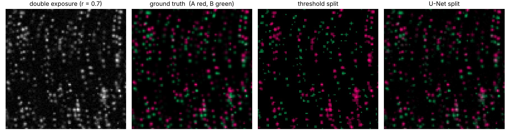
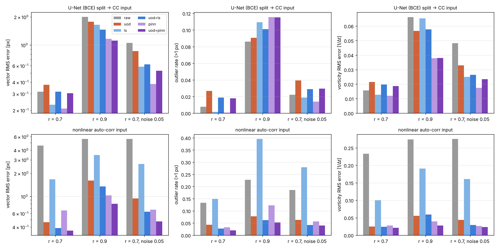
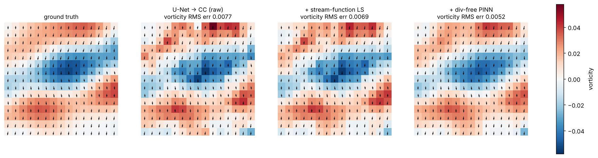

# PIV term project — AI separation of pulse-coded double exposures + div-free post-processing

## 문제
Single-frame / double-exposure PIV는 auto-correlation으로 변위를 구하지만, 상관함수가
대칭(R(s) = R(−s))이라 **방향 모호성**이 생긴다 (Ch4 p.30, 33).
두 펄스가 똑같으면 영상 자체가 방향에 대해 대칭이므로 어떤 알고리즘(AI 포함)으로도 부호를 알 수 없다.

강의 p.34의 해결책 중 **pulse coding**(두 펄스 세기를 다르게: I₂ = r·I₁, r < 1)을 사용하고,
U-Net이 한 장의 double exposure를 **frame A(1st pulse) / frame B(2nd pulse)** 로 분리하게 한 뒤
일반 cross-correlation을 적용한다 → auto-correlation 문제를 cross-correlation 문제로 변환.

어려운 점: 입자 밝기는 light sheet 안의 z 위치에 따라 크게 달라서(가우시안 sheet profile),
밝기만으로는 1st/2nd를 가를 수 없다. 같은 입자 쌍(밝기 비 r, 주변과 같은 변위)이라는 **문맥**을 써야 한다.

## 구성
| 파일 | 내용 |
|---|---|
| `pivsep/synth.py` | 합성 PIV 영상 생성 (비압축 랜덤 유동 + Lamb–Oseen 와류, erf 적분 가우시안 입자, light-sheet 밝기 분포, 면외 운동, 노이즈) |
| `pivsep/correlation.py` | FFT cross-correlation / auto-correlation / 비선형 auto-correlation ΣI²(x)I(x+s), 3-point Gaussian subpixel |
| `pivsep/separation.py` | 고전 기법(blob 밝기 + Otsu 임계값) 분리, U-Net 분리 (soft mask, A+B=I 보존) |
| `scripts/train_sep.py` | U-Net 학습 (r ∈ [0.45, 0.95], 밀도·노이즈·입자 크기 랜덤) |
| `scripts/evaluate.py` | r, 입자 밀도, 노이즈 sweep 평가 |
| `scripts/make_figures.py` | 1단계 그림 |
| `pivsep/postproc.py` | 2단계: UOD + 중앙값 대체, 강건 stream-function LS, 발산 0 PINN |
| `scripts/evaluate_postproc.py`, `scripts/make_figures_postproc.py` | 2단계 평가·그림 |

## 실행
```bash
python -m venv .venv && . .venv/bin/activate && pip install -r requirements.txt
python scripts/train_sep.py --steps 4000 --n-train 6000 --loss bce --ppp-max 0.08 --noise-max 0.05 \
    --out results/sep_unet_wide_bce.pt                                   # CPU 약 1.5시간
python scripts/evaluate.py --model v1=results/sep_unet.pt wide_mse=results/sep_unet_wide_mse.pt \
    wide_bce=results/sep_unet_wide_bce.pt --out results/eval_stage1.json
python scripts/make_figures.py --model results/sep_unet_wide_bce.pt --eval results/eval_stage1.json --tag _stage1
python scripts/evaluate_postproc.py --model results/sep_unet_wide_bce.pt
python scripts/make_figures_postproc.py
```

## 비교 방법
- `gt_cc` : 정답 A, B로 cross-correlation (상한)
- `auto` : auto-correlation, 부호는 관례(dx>0)로 선택 → 방향 모호
- `asym` : 비선형 auto-correlation ΣI²(x)I(x+s). +d 피크 ∝ r, −d 피크 ∝ r² 이므로 큰 쪽이 방향 (고전 기법 baseline)
- `thr_cc` : blob 밝기 임계값 분리 → CC
- `unet_cc` : U-Net 분리 → CC (제안)

평가: interrogation window 32×32, step 16 (50 % overlap), 256×256 영상 12장(조건당 2700 벡터).
지표: outlier 비율(|오차| > 1 px), 방향 오류 비율(u·u_gt < 0), median 오차.

## 1단계 결과 — 펄스 분리 (U-Net 3종 비교)
| 모델 | 학습 범위 | 손실 | step |
|---|---|---|---|
| v1 | ppp ≤ 0.05, noise ≤ 0.03 | MSE (재구성) | 3000 |
| wide_mse | ppp ≤ 0.08, noise ≤ 0.05 | MSE | 4000 |
| **wide_bce** | ppp ≤ 0.08, noise ≤ 0.05 | 밝기 가중 BCE (픽셀 분류) | 4000 |

outlier 비율(|오차|>1 px) / 방향 오류 비율 / median 오차 (12장, 조건당 2700 벡터; 기본 ppp 0.03, noise 0.015)

| 조건 | 비선형 auto-corr | v1 | wide_mse | **wide_bce** | 정답 A/B→CC |
|---|---|---|---|---|---|
| r = 0.95 | 32.7% / 28.1% / 0.37 | 30.5% / 15.1% / 0.25 | 39.1% / 22.7% / 0.31 | **31.4% / 16.7% / 0.24** | 0.4% / 0% / 0.14 |
| r = 0.9 | 20.9% / 16.1% / 0.30 | 9.0% / 3.9% / 0.18 | 12.2% / 6.4% / 0.18 | **7.1% / 3.0% / 0.17** | 0.4% / 0% / 0.14 |
| r = 0.8 | 13.1% / 7.7% / 0.26 | 2.4% / 1.1% / 0.17 | 2.9% / 1.4% / 0.16 | **1.5% / 0.6% / 0.16** | 0.4% / 0% / 0.14 |
| r = 0.7 | 11.9% / 5.9% / 0.26 | 1.3% / 0.4% / 0.16 | 1.1% / 0.3% / 0.16 | **0.6% / 0.0% / 0.15** | 0.4% / 0% / 0.14 |
| r = 0.5 | 22.5% / 10.1% / 0.32 | 0.8% / 0.0% / 0.16 | 0.9% / 0.1% / 0.16 | **0.6% / 0.0% / 0.16** | 0.4% / 0% / 0.14 |
| ppp 0.09 (r 0.7) | 12.4% / 7.6% | 24.9% / 11.5% | 9.3% / 5.7% | **7.9% / 4.4%** | 0.2% / 0% |
| noise 0.07 (r 0.7) | 20.2% / 11.2% | 26.7% / 12.6% | 13.1% / 6.5% | **6.9% / 2.9%** | 0.4% / 0% |

국소 속도 구배별 outlier 비율 (r = 0.7, 창 하나에 걸친 속도 차 |∇d|·32)

| 구배 | 비선형 auto-corr | wide_bce | 정답 A/B→CC |
|---|---|---|---|
| 0–1 px (n=1233) | 5.5% | 0.0% | 0.0% |
| 1–2 px (n=991) | 11.5% | 0.0% | 0.0% |
| 2–4 px (n=462) | 27.7% | 1.5% | 1.1% |
| > 4 px (n=14) | 86% | 57% | 43% |





### 관찰
1. 일반 auto-correlation은 r과 무관하게 방향을 알 수 없다 (상관함수 대칭; 방향 오류 ≈ 56 %).
2. 밝기 임계값 분리는 light-sheet z 위치에 따른 밝기 편차 때문에 실패 → **입자 쌍 문맥**이 필요.
3. U-Net 분리 → CC (wide_bce)는 r ≤ 0.8에서 outlier ≤ 1.5 %, 방향 오류 ≤ 0.6 %로 정답 A/B 상한에 근접.
   픽셀 오분류율이 ~20 %여도 CC는 창 평균이라 다수 입자 쌍만 맞으면 된다.
4. 학습 범위 확장이 일반화에 결정적 (v1은 범위 밖 고밀도·고노이즈에서 고전 기법보다 나빠짐).
   BCE(픽셀 분류) 손실이 MSE(재구성)보다 모든 조건에서 우수.
5. 큰 속도 구배(창 안 Δu > 4 px)에서는 정답 A/B로도 실패 — 강의 p.32 interrogation spot 조건(Δu/u < 0.2)의 한계.
6. r → 1 (0.95)은 정보가 사라져 모든 방법이 실패.

## 2단계 결과 — 질량 보존(∇·u = 0) 후처리
입력: wide_bce U-Net 결과, 비교용으로 비선형 auto-corr 결과. 8장 × 3 조건.
| 후처리 | 내용 |
|---|---|
| uod | universal outlier detection(정규화 중앙값 검사) + 중앙값 대체 (표준 PIV 후처리) |
| ls | Huber-IRLS 강건 stream-function 최소자승 → 이산 발산 = 0 |
| pinn | stream-function MLP(Fourier feature), u = ∂ψ/∂y, v = −∂ψ/∂x (발산 0 hard constraint), Huber + 와도 평활 정규화 |

r = 0.7 (U-Net 입력)

| 후처리 | median | RMS | outlier | 조밀 격자 RMS | 와도 RMS 오차 |
|---|---|---|---|---|---|
| raw | 0.168 | 0.317 | 0.8% | 0.274 | 0.0157 |
| uod | 0.180 | 0.375 | 2.7% | 0.296 | 0.0215 |
| ls | 0.151 | 0.229 | 0.2% | 0.209 | 0.0127 |
| **pinn** | **0.138** | **0.208** | **0.1%** | **0.197** | **0.0120** |

r = 0.7, noise 0.05 (U-Net 입력): RMS 1.05 → **0.38 (pinn)**, 와도 오차 0.048 → **0.018** (−64 %).

비선형 auto-corr 입력 (outlier 많음), r = 0.7: RMS 4.60 → uod 0.46 → **uod+pinn 0.36**, 와도 오차 0.233 → 0.021.




### 관찰
1. **outlier가 적은 입력(U-Net)에는 발산 0 피팅(pinn, ls)만으로 충분**: 노이즈 감소, 와도 오차 −24 % (r 0.7) ~ −64 % (noise 0.05).
   반대로 UOD는 와류 근처의 정상 벡터를 outlier로 잘못 판정해 오히려 악화.
2. **outlier가 많은 입력(비선형 auto-corr)은 UOD를 먼저** 해야 함. outlier를 그대로 피팅하면(ls, pinn 단독) 오차가 주변으로 번짐.
3. **군집 오차는 못 고친다**: r = 0.9에서 U-Net의 방향 오류는 영역 단위로 뭉쳐 있어 (주변도 같이 틀림) 후처리 후에도 outlier ≈ 11 %.
   반면 비선형 auto-corr의 오류는 고립된 부호 반전이라 uod+pinn으로 5 %까지 감소 → r ≈ 0.9 영역에서는 두 방법의 결합이 유망.
4. 평면 PIV에서 실제 3D 유동은 ∂u/∂x + ∂v/∂y = −∂w/∂z ≠ 0. 본 결과는 2D 비압축 합성 유동 가정에 의존.

## 선행 연구와의 관계
- 방향 모호성과 pulse coding / image shifting: 1980년대 특허, Raffel et al., 강의 p.33–34
- 비대칭 auto-correlation: Marzouk & Hart (1998, Exp. Fluids)
- 신경망으로 double exposure 입자 쌍 식별: Exp. Fluids (1998)
- 광학적 다중 노출 코딩·분리: FRAME (Lund 그룹; 구조화 조명 + Fourier 분리), SLIPI 계열
- 딥러닝 PIV (2-frame): PIV-DCNN, PIV-LiteFlowNet, RAFT-PIV, PIVNO 등
- 발산 0 후처리 / stream-function 신경망: de Silva 등, Vedula & Adrian, PINN 기반 PIV 보정
- 본 프로젝트의 차별점: **밝기 코딩 + CNN 분리 → 표준 CC** 결합과, z-밝기 편차 하에서의 정량 비교

## 한계와 향후 연구
- 합성 데이터만 사용 (실제 영상: 레이저 프로파일, 반사, 카메라 MTF 미반영) → 실험 영상 검증 필요
- r → 1, 큰 속도 구배, 고밀도에서 성능 저하 → multi-pass / window deformation 결합, 분리 후 PTV
- U-Net + 비선형 auto-corr 결합(앙상블)으로 군집 방향 오류 감소
- stereo / tomographic PIV로 확장 시 3D 발산(벡터 퍼텐셜) 적용
